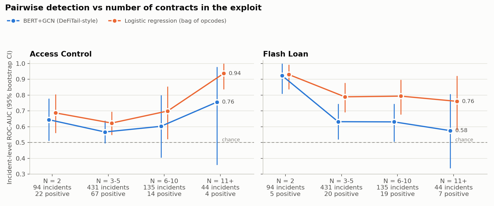

# Objective 1 — Topological Limits of Pairwise Cross-Contract Vulnerability Detection

## 1. Question
DeFiTail, the only learned cross-contract detector, connects exactly two contracts (attacker and victim) and classifies
the stitched execution paths. Real exploits often involve more contracts. This study measures how a DeFiTail-style
pairwise detector performs as the number of contracts in an exploit, N, grows: buckets 2, 3–5, 6–10 and 11+.

**Answer in one line:** for flash-loan exploits, detection is significantly worse once N ≥ 3; for access-control
exploits there is no measurable effect of N. Overall accuracy of the reproduced detector is modest, and a bag-of-opcodes
baseline outperforms it.

## 2. Data
DeFiTail's data paths are not public (its figshare artifact holds code and a 91-file sample only), so the study uses
**DeFiHackLabs** (869 reproduced real-world DeFi exploits, Apache-2.0) as the incident source.

- **Contracts per incident**: every address in the exploit PoC, with bytecode fetched at the pre-attack block from public
  archive nodes (6,197 lookups across 7 chains). Addresses without code (wallets) are dropped.
- **N** = protocol contracts + 1 attacker, excluding shared infrastructure (contracts used by 5+ incidents on a chain, such
  as WETH, stablecoins and DEX routers).
- **Labels** (two binary tasks, as in DeFiTail): *access control* and *flash loan*, from keyword matching on
  DeFiHackLabs' vulnerability description. Negatives are exploits of other types, as in DeFiTail's setup.

| Bucket (N) | Incidents | Access-control + | Flash-loan + | Paths |
|---|---|---|---|---|
| 2 | 94 | 22 | 5 | 409 |
| 3–5 | 431 | 67 | 20 | 5,307 |
| 6–10 | 135 | 14 | 19 | 3,200 |
| 11+ | 44 | 4 | 7 | 1,332 |
| **Total** | **704** | **107** | **51** | **10,248** |

61 of 765 incidents with bytecode were dropped (12 PoCs fail to compile, 49 yield no feasible attacker path).

## 3. Method
**DeFiTail, re-implemented**
1. **Attacker contract**: the PoC compiled with solc; forge-std test helpers excluded.
2. **Victim contracts**: on-chain runtime bytecode; proxies resolved to implementations (330 of 417).
3. **Data paths**: per public function, a bounded DFS over the bytecode with a symbolic stack. A path is kept only if all
   jump targets resolve and the stack never underflows (DeFiTail's stack-height feasibility check), and it terminates
   successfully.
4. **Pairwise stitching**: at each external call, the called function is identified by its 4-byte selector and the victim's
   function path is spliced in. Only **one** victim is stitched per path, so for an exploit with N contracts the detector
   sees N−1 separate attacker–victim views and never the full chain.
5. **Model**: BERT over each path plus a 2-layer GCN over the path/opcode graph (PPMI and TF-IDF edges), fused 50/50.

**Reference baseline**: logistic regression on TF-IDF of opcode unigrams and bigrams, same folds.

**Evaluation**: 5-fold cross-validation by incident (no incident in both train and test), stratified by bucket and
label, repeated over 3 seeds; every incident is tested once per seed. An incident is flagged if any of its paths is.
Main metric: incident-level **ROC-AUC** with 2,000-sample bootstrap 95% CIs. F1 at a 0.5 threshold is also reported, but
it depends on each bucket's share of positives, which varies a lot (access control: 23% at N=2, 9% at N=11+).

**Deviations from the paper** (CPU-only machine): BERT shrunk to 2 layers / 128 hidden / 256 tokens (the paper's size
would take ~60 h for this protocol); one encoder with two task heads; stack-only opcodes removed from paths.

## 4. Results

### 4.1 Main figure

### 4.2 Incident-level ROC-AUC (95% bootstrap CI)

| Task | Model | N = 2 | N = 3–5 | N = 6–10 | N = 11+ | All |
|---|---|---|---|---|---|---|
| Access control | BERT+GCN | 0.65 (0.51–0.78) | 0.57 (0.49–0.64) | 0.60 (0.41–0.80) | 0.76 (0.36–0.98) | 0.59 (0.53–0.65) |
| Access control | LogReg | 0.69 (0.56–0.81) | 0.62 (0.55–0.70) | 0.70 (0.52–0.86) | 0.94 (0.84–1.00) | 0.66 (0.60–0.72) |
| Flash loan | BERT+GCN | 0.92 (0.81–1.00) | 0.63 (0.52–0.75) | 0.63 (0.51–0.75) | 0.58 (0.34–0.81) | 0.69 (0.62–0.75) |
| Flash loan | LogReg | 0.93 (0.84–0.99) | 0.79 (0.69–0.88) | 0.79 (0.68–0.90) | 0.76 (0.58–0.92) | 0.82 (0.76–0.87) |

### 4.3 N = 2 versus N ≥ 3 (AUC difference, bootstrap 95% CI)

| Task | Model | AUC at N=2 | AUC at N≥3 | Difference | 95% CI |
|---|---|---|---|---|---|
| Access control | BERT+GCN | 0.65 | 0.58 | +0.07 | −0.08 to +0.21 |
| Access control | LogReg | 0.69 | 0.66 | +0.03 | −0.11 to +0.17 |
| Flash loan | BERT+GCN | 0.92 | 0.65 | **+0.28** | **+0.15 to +0.39** |
| Flash loan | LogReg | 0.93 | 0.80 | **+0.13** | **+0.02 to +0.23** |

### 4.4 Thresholded metrics (BERT+GCN, mean ± sd over 3 seeds)

| Task | Metric | N = 2 | N = 3–5 | N = 6–10 | N = 11+ |
|---|---|---|---|---|---|
| Access control | F1 | 0.40 ± 0.03 | 0.28 ± 0.00 | 0.19 ± 0.01 | 0.22 ± 0.04 |
| Access control | F1 at equal positive share* | 0.30 | 0.25 | 0.24 | 0.29 |
| Flash loan | F1 | 0.26 ± 0.05 | 0.11 ± 0.01 | 0.28 ± 0.03 | 0.27 ± 0.02 |
| Flash loan | F1 at equal positive share* | 0.35 | 0.18 | 0.18 | 0.15 |

\* F1 recomputed from each bucket's true- and false-positive rates as if every bucket had the overall positive share
(15.2% access control, 7.2% flash loan), which removes the base-rate effect.

Seed-to-seed spread is small (F1 sd ≤ 0.05; AUC sd ≤ 0.09), so the uncertainty is dominated by the small number of
positive incidents, not by training randomness.

## 5. Where performance drops, and why
1. **Flash-loan detection degrades beyond N = 2.** Both models are near-perfect at N=2 (AUC 0.92–0.93) and drop for
   every N ≥ 3 bucket; the difference is significant for both. A flash-loan exploit typically chains a lender, one or
   more pools or oracles, and the target protocol. In the pairwise view each path shows the attacker with only one of
   them, so the manipulation sequence that defines the attack (borrow, move a price, exploit the price, repay) is split
   across separate views and no single path carries the whole pattern. Beyond N = 3 the curve is roughly flat: once the
   chain is split, splitting it further costs little extra.
2. **Access-control detection shows no N effect.** The raw F1 drops from 0.40 to about 0.2, but that drop disappears when
   the positive share is held equal (0.30 → 0.29) and the AUC differences are not significant. This fits the mechanism:
   an access-control flaw usually sits in one victim function (a missing owner check), which a single attacker–victim
   pair can capture regardless of how many other contracts the protocol has.
3. **The reproduced deep model is weak overall**, and below the simple baseline (AUC 0.59 vs 0.66 for access control,
   0.69 vs 0.82 for flash loan). Likely causes: a model shrunk to fit a CPU and trained for 4 epochs, 256-token windows over
   paths with a median of 851 tokens, and noisy keyword labels. Because the baseline shows the same flash-loan drop, that
   drop is a property of the pairwise data view, not of this particular model.

**Implication for the project:** the flash-loan result motivates Objectives 2–3 (an N-ary, typed representation that
keeps the whole call chain in one view); the access-control result suggests the gain from N-ary modelling will be
category-dependent, which the later evaluation should report per category.

## 6. Limitations
- **Not comparable to DeFiTail's 98.39% / 97.43%**: different data, label definitions and model size.
- **Labels are keyword heuristics**; 50 incidents are listed in `label_review.csv` for manual checking. Results should be
  re-run if many labels prove wrong.
- **Small positive counts**: the N=2 flash-loan result rests on 5 positive incidents (its CI is still clear of the N≥3
  value); access control at N=11+ has 4. Single-bucket values with wide CIs (e.g. LogReg 0.94 at access control 11+)
  should not be over-read.
- **Buckets differ in vulnerability mix and protocol type as well as in N**, so N is not the only thing that changes across
  buckets; a matched comparison would need more data.
- **Static stitching**: callees are identified by selector, not executed; 50% of paths contain at least one stitch.
- **Model size**: a full-size BERT on a GPU could raise all numbers; whether it would also close the flash-loan gap is
  untested.

## 7. Files
- Data: `data/processed/paths.csv`, `data/processed/dhl_incidents.csv` (built by `build_dataset.ipynb`)
- Experiment: `objective1.ipynb`
- Results: `results/degradation_auc.png` (main figure), `results/degradation.png` (F1 by bucket),
  `results/auc_by_bucket_ci.csv`, `results/auc_difference_N2_vs_N3plus.csv`, `results/auc_ci_and_prevalence_adjusted.csv`,
  `results/metrics_summary.csv`, `results/metrics_per_seed.csv`, `results/oof_predictions.csv`,
  `results/baseline_logreg_*`
