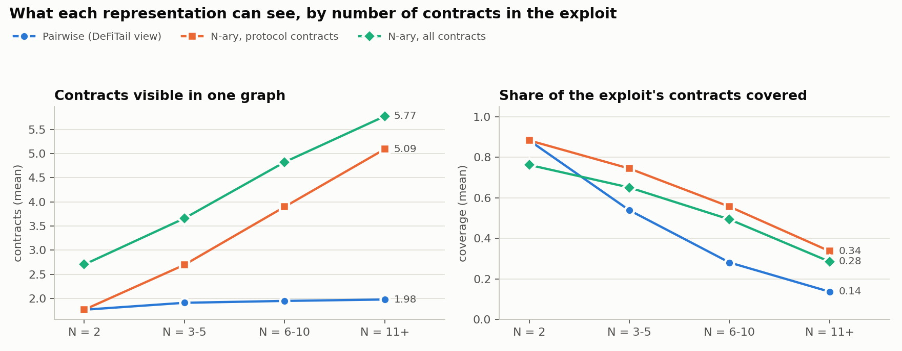
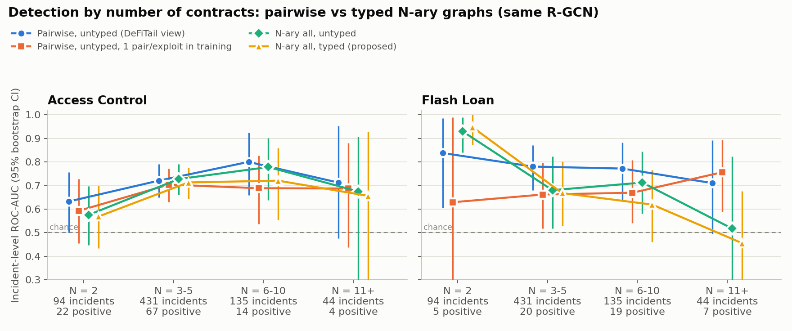

# Objective 2 — A Typed N-ary Graph Representation for Multi-Contract Exploits

## 1. Goal
Objective 1 showed that a pairwise (attacker + one victim) view loses flash-loan detection accuracy once an exploit
involves three or more contracts. Objective 2 designs a representation that is **not limited to two contracts**: every
contract the exploit touches is connected in one graph, and each cross-contract link carries a **type** saying why the
contracts are linked. The representation is then compared with the pairwise view under one fixed model.

**Answer in one line:** the representation works as designed: it sees 2.5–3× more of each exploit at large N. But with a
standard relational GNN it does **not** improve detection. At equal training data it ties the pairwise view, typed edges do
not help, and very large graphs (N ≥ 11) lose the flash-loan signal. This points to the architecture changes planned for
Objective 3.

## 2. Representation

### 2.1 Graph construction (per exploit)
- **Nodes**: basic blocks visited by feasible execution traces, starting from the attacker's exploit functions (the same
  stack-height-validated search as Objective 1). Node features: opcode histogram (85 opcode types), block size, contract role
  (attacker / protocol / shared infrastructure), call depth.
- **N-ary chaining**: at every CALL / STATICCALL / DELEGATECALL / CALLCODE, the callee is resolved and its trace stitched in
  **recursively**, up to depth 3, including callbacks into the attacker. The callee is resolved by the contract address pushed
  as a constant before the call; if there is none, by matching the 4-byte selector against the exploit's contracts.
- **Typed edges (7 types)**

| Type | Meaning | Count (N-ary all) |
|---|---|---|
| `cfg` | control flow inside a contract | 255,163 |
| `call_write` | call into a function that writes storage | 4,132 |
| `call_read` | read-only call (STATICCALL, or callee writes nothing) | 5,504 |
| `delegate` | DELEGATECALL / CALLCODE (callee runs in caller's storage) | 76 |
| `return` | callee's last block back to the caller | 9,664 |
| `revert_guard` | caller checks the call's result and reverts on failure (`require(success)`) | 9,161 |
| `storage_dep` | SSTORE followed by SLOAD of the same storage slot | 3,179 |

### 2.2 Variants
| Variant | Contracts in one graph |
|---|---|
| **Pairwise** (DeFiTail view) | attacker + 1 protocol contract; one graph per pair, exploit score = max over pairs |
| **N-ary protocol** | attacker + all protocol contracts |
| **N-ary all** (proposed) | attacker + all contracts, including shared tokens, lenders and routers |

Each variant is built **typed** (7 edge types) and **untyped** (one type), giving six configurations. All 704 exploits from
Objective 1 were built in every variant with no failures (pairwise: 2,756 graphs; N-ary: 704 each).

### 2.3 What each view can see

| Bucket (N) | Pairwise: contracts / coverage | N-ary protocol: contracts / coverage | N-ary all: contracts / coverage* | N-ary all: max call depth |
|---|---|---|---|---|
| 2 | 1.77 / 0.88 | 1.77 / 0.88 | 2.70 / 0.76 | 1.74 |
| 3–5 | 1.91 / 0.54 | 2.70 / 0.74 | 3.66 / 0.65 | 2.10 |
| 6–10 | 1.95 / 0.28 | 3.90 / 0.56 | 4.82 / 0.49 | 2.36 |
| 11+ | 1.98 / 0.14 | 5.09 / 0.34 | 5.77 / 0.28 | 2.25 |

\* N-ary all's coverage is measured against all contracts including shared ones, so it is not directly comparable with the
other two columns.

The pairwise view is capped at two contracts, so its coverage collapses from 88% to 14% as N grows. The N-ary graphs grow
with the exploit, reaching 5–6 contracts at N ≥ 11, about 2.5× the pairwise coverage. Coverage stays below 100% because some
calls cannot be resolved statically (e.g. callee addresses loaded from storage).

## 3. Evaluation protocol
- **Model** (identical across configurations): 3-layer R-GCN (64 hidden, 4 bases, residual + LayerNorm) with mean + max
  pooling and two task heads. "Untyped" means one relation, so the network is otherwise identical. Inverse edges are added as
  separate relations.
- **Data and labels**: the 704 exploits and keyword labels from Objective 1.
- **Cross-validation**: 5-fold by incident × 3 seeds, the same protocol as Objective 1; 25 epochs, class-weighted loss.
- **Metrics**: incident-level ROC-AUC with bootstrap 95% CIs; paired bootstrap tests on the same incidents.
- **Control**: the pairwise variant has ~4× more training graphs (one per pair). A control run trains pairwise on **one random
  pair per exploit**, the same 563 graphs per fold as N-ary, and tests it the same way.

## 4. Results

### 4.1 Incident-level ROC-AUC (all exploits)

| Configuration | Access control | Flash loan |
|---|---|---|
| Pairwise, untyped (DeFiTail view) | 0.72 (0.67–0.78) | **0.79** (0.72–0.86) |
| Pairwise, typed | 0.71 (0.65–0.76) | 0.73 (0.65–0.81) |
| N-ary protocol, untyped | 0.72 (0.67–0.77) | 0.74 (0.67–0.80) |
| N-ary protocol, typed | **0.73** (0.68–0.77) | 0.67 (0.59–0.75) |
| N-ary all, untyped | **0.73** (0.67–0.77) | 0.72 (0.64–0.81) |
| N-ary all, typed (proposed) | 0.70 (0.65–0.76) | 0.69 (0.61–0.77) |
| Control: pairwise, untyped, 1 pair per exploit in training | 0.68 (0.62–0.73) | 0.71 (0.62–0.79) |
| *Objective 1: BERT+GCN on paths* | 0.59 (0.53–0.65) | 0.69 (0.62–0.75) |
| *Objective 1: logistic regression on paths* | 0.66 (0.60–0.72) | 0.82 (0.76–0.87) |

Per-bucket values for every configuration are in `results_o2/auc_by_bucket_ci.csv`.

### 4.2 Key tests (paired bootstrap, AUC difference, 95% CI)

| Question | Access control | Flash loan |
|---|---|---|
| N-ary all untyped − pairwise control (equal training data), all exploits | +0.05 (−0.01 to +0.11) | +0.02 (−0.07 to +0.10) |
| same, N ≥ 3 only | +0.04 (−0.02 to +0.10) | −0.01 (−0.10 to +0.07) |
| Pairwise full − pairwise control (effect of 4× training graphs) | +0.05 (−0.01 to +0.10) | **+0.08 (+0.02 to +0.15)** |
| Typed − untyped, N-ary all | −0.02 (−0.06 to +0.01) | −0.03 (−0.09 to +0.03) |
| Typed − untyped, N-ary protocol | +0.00 (−0.04 to +0.04) | **−0.07 (−0.13 to −0.00)** |
| Typed − untyped, pairwise | −0.02 (−0.05 to +0.02) | **−0.06 (−0.11 to −0.02)** |
| N-ary all − N-ary protocol (typed) | −0.02 (−0.06 to +0.02) | +0.02 (−0.07 to +0.11) |

Within-configuration degradation, flash loan, AUC at N=2 minus N ≥ 3:

| Configuration | Difference (95% CI) |
|---|---|
| Pairwise untyped | +0.06 (−0.20 to +0.23), not significant |
| N-ary all untyped | +0.24 (+0.11 to +0.35) |
| N-ary all typed | +0.30 (+0.19 to +0.40) |

## 5. Interpretation
1. **The representation goal is met.** N-ary graphs see 2.5× more of large exploits, follow calls 2–3 levels deep, and label
   cross-contract links by type. At N = 2 the pairwise and N-ary-protocol graphs are identical, a built-in sanity check.
2. **Under a standard R-GCN, seeing more does not yet mean detecting better.** At equal training data, N-ary and pairwise are
   statistically tied for both tasks. The pairwise view's apparent lead in flash-loan AUC (0.79) comes from training on ~4×
   more graphs: one graph per pair acts as data augmentation.
3. **Typed edges do not help this model**, and they hurt flash-loan detection in two of three variants. Fourteen relation
   types (7 + inverses) split the message passing across many sparsely populated relations, which 563 training graphs cannot
   support.
4. **Large N-ary graphs lose the flash-loan signal.** N-ary all is best of all configurations at N = 2 (0.93–0.95), because
   the shared flash-loan lender is inside the graph. But it falls to near chance at N ≥ 11 (0.46–0.52), where graphs have 400+
   nodes, mostly `cfg`. Mean/max pooling over the whole graph dilutes the few cross-contract nodes that matter.
5. **Graph form beats the paths of Objective 1 for access control** (0.70–0.73 vs 0.59–0.66): block-level structure helps
   regardless of the contract count.

**Implications for Objective 3** (GAT + Mamba + cross-contract attention pooling), each addressing an observed failure:
- **Attention pooling weighted towards cross-contract nodes**, against dilution in large graphs (point 4).
- **Sub-chain augmentation** (sample connected sub-graphs of an N-ary graph during training), to recover the pairwise view's
  data advantage without giving up the full chain at test time (point 2).
- **Attention over edge types / fewer relation parameters**, so typing can help rather than fragment learning (point 3).
- **A sequence model (Mamba) over execution order**, for long multi-contract traces.

## 6. Limitations
- **Static call resolution**: coverage is below 100% (unresolved callees, proxies whose implementation was not found).
- **Labels** are Objective 1's keyword heuristics (see `label_review.csv`); positives are few in some buckets (5 flash-loan
  at N = 2, 4 access-control at N ≥ 11), so per-bucket CIs are wide.
- **One model, no hyperparameter search**: the conclusions concern the representation under a standard R-GCN, not the best
  achievable detector.
- **Trace sampling**: one feasible path per function, so alternative branches inside a function are not in the graph.

## 7. Files (inside `objective1/`)
- `objective2.ipynb`: build graphs, representation analysis, training, tests and figures (cached; runs top to bottom).
- `data/processed/o2_graphs/`: `pairwise.npz`, `nary_protocol.npz`, `nary_all.npz`, `graph_stats.csv`.
- `results_o2/`: `representation_coverage.png`, `auc_by_bucket.png`, `representation_stats.csv`,
  `auc_by_bucket_ci.csv`, `tests.csv`, `oof_*.csv`, per-fold checkpoints, `train.log`.
